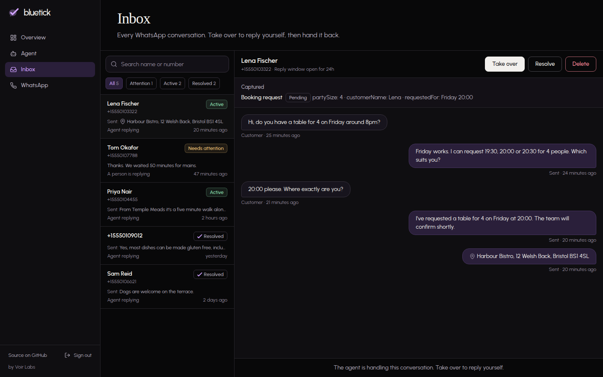

<div align="center">


# Bluetick

**AI agents for WhatsApp, defined in code. Self-hosted, on the official WhatsApp Cloud API.**

[](https://github.com/voirlabs/bluetick/actions/workflows/ci.yml)
[](LICENSE)



</div>

## What it does

- Answers your customers on WhatsApp. One agent per deployment replies through Meta's official Cloud API. Signed webhooks, the 24-hour service window and STOP/START opt-outs are handled for you.
- Developers write the agent's tools and hooks in TypeScript with `defineAgent` and `defineTool`. The business edits the prompt, business details, escalation rules and which tools are on in the dashboard.
- Voice notes are transcribed, and the transcript shows in the inbox. Photos go to the model with the customer's message.
- The agent answers from your documents: upload PDFs, Markdown or text, or add public web pages and snippets. It searches them with pgvector.
- Keyword rules, the agent itself or a tool can hand a conversation to a person in the inbox. Reply from there and hand it back in one click. Captured leads and booking requests show next to the chat, and an alert goes to Slack, Discord, or anywhere via Zapier, Make or n8n when someone needs you.
- Built-in tools post leads and requests to your CRM, Zapier or Make, or a Google Sheet. The overview shows this month's messages, handoff rate, model tokens and how many of Meta's 1,000 free service messages per number you've used.
- The simulator runs the same agent with side effects switched off, and you can unit-test an agent without WhatsApp, a database or an API key.

## How it works

```
WhatsApp ──▶ Meta Cloud API ──webhook──▶ /api/webhooks/whatsapp   checks X-Hub-Signature-256, answers 200
                                               │ after()
                                               ▼
                                         handle-inbound           store + dedupe, opt-out, handoff, paused?
                                               │
                                               ▼
                       agent.config.ts ──▶ runAgent()             prompt from the dashboard + your tools and hooks
                                               │                  (@bluetick/agent: no I/O of its own)
                                               ▼
                                         Graph API send ──▶ WhatsApp
```

`runAgent()` lives in [`packages/agent`](packages/agent). WhatsApp, the dashboard simulator and
your tests all call it with different services, so what you test is what runs. Everything else
is one Next.js app in [`apps/web`](apps/web) with PostgreSQL (and pgvector) behind it.

## Quickstart

Requires Node.js 24, [pnpm](https://pnpm.io) 10, PostgreSQL with pgvector, and an OpenAI key
(or any OpenAI-compatible API).

```bash
git clone https://github.com/voirlabs/bluetick.git
cd bluetick
pnpm install
docker compose up -d                      # or any Postgres with pgvector, e.g. Neon or Supabase
cp apps/web/.env.example apps/web/.env    # set ADMIN_PASSWORD and OPENAI_API_KEY
pnpm db:setup                             # create the tables
pnpm dev
```

Open http://localhost:3000, sign in with `ADMIN_PASSWORD` and describe your business. The setup
assistant writes the configuration. Add documents under **Knowledge** and try the agent in the
**Simulator** tab.

To connect WhatsApp, follow [docs/whatsapp-setup.md](docs/whatsapp-setup.md). The dashboard's
**WhatsApp** page checks each step (credentials, token expiry, the app secret, the webhook
subscription) and says what to fix. Meta's free test number works without business verification.
Locally you need a tunnel (ngrok, cloudflared) so Meta can reach the webhook.

To customize the agent, edit [`apps/web/agent.config.ts`](apps/web/agent.config.ts) or copy one of
the [examples](#examples): see [docs/customizing-the-agent.md](docs/customizing-the-agent.md).

## Configuration

All configuration is through environment variables in `apps/web/.env`. See
[`apps/web/.env.example`](apps/web/.env.example).

| Variable                       | Default                      | Purpose                                                                                                                                                     |
| ------------------------------ | ---------------------------- | ----------------------------------------------------------------------------------------------------------------------------------------------------------- |
| `DATABASE_URL`                 |                              | Required. PostgreSQL with the pgvector extension                                                                                                            |
| `NEXT_PUBLIC_APP_URL`          | `http://localhost:3000`      | Public base URL. Meta delivers webhooks here                                                                                                                |
| `ADMIN_PASSWORD`               |                              | Required. Password for the dashboard; at least 12 characters in production (`openssl rand -base64 18`). Changing it signs everyone out                      |
| `SESSION_SECRET`               | dev-only fallback            | Required in production. Signs the session cookie (`openssl rand -hex 32`)                                                                                   |
| `TRUSTED_PROXY_HOPS`           | `1` on Vercel, else `0`      | Reverse proxies whose `X-Forwarded-For` you trust, for the login rate limit                                                                                 |
| `WHATSAPP_PHONE_NUMBER_ID`     |                              | Required for WhatsApp. Meta app → Customize use case → API Setup                                                                                            |
| `WHATSAPP_ACCESS_TOKEN`        |                              | Required for WhatsApp. Graph API token; use a System User token in production                                                                               |
| `WHATSAPP_APP_SECRET`          |                              | Required for WhatsApp. Meta app → App settings → Basic; verifies webhook signatures                                                                         |
| `WHATSAPP_VERIFY_TOKEN`        |                              | Required for WhatsApp. Any random string, also entered in Meta's webhook setup                                                                              |
| `WHATSAPP_GRAPH_VERSION`       | `v26.0`                      | Graph API version                                                                                                                                           |
| `WHATSAPP_GRAPH_BASE_URL`      | `https://graph.facebook.com` | Graph API base URL, for a mock server or proxy                                                                                                              |
| `WHATSAPP_BUSINESS_ACCOUNT_ID` |                              | WhatsApp Business Account ID. Lets the inbox send approved templates, and picks the account to check and subscribe if the token reaches several             |
| `OPENAI_API_KEY`               |                              | Required. Key for OpenAI or the API in `OPENAI_BASE_URL`                                                                                                    |
| `OPENAI_BASE_URL`              | OpenAI                       | Any OpenAI-compatible API: Ollama, OpenRouter, LM Studio, a proxy                                                                                           |
| `OPENAI_MODEL`                 | `gpt-5.4-mini`               | Model for replies, unless `agent.config.ts` sets one. Must accept images for photos                                                                         |
| `OPENAI_BUILDER_MODEL`         | `gpt-5.4-mini`               | Model for the setup assistant                                                                                                                               |
| `OPENAI_EMBEDDING_MODEL`       | `text-embedding-3-small`     | Knowledge-base embeddings; must return 1536 dimensions                                                                                                      |
| `OPENAI_TRANSCRIBE_MODEL`      | `gpt-4o-mini-transcribe`     | Transcribes customers' voice notes                                                                                                                          |
| `CUSTOMER_MESSAGES_PER_10_MIN` | `20`                         | Messages one customer may send in 10 minutes before the agent stops answering them and the chat goes to the inbox (`0` = no limit)                          |
| `CUSTOMER_MESSAGES_PER_DAY`    | `150`                        | The same over 24 hours                                                                                                                                      |
| `PRIVACY_CONTACT_EMAIL`        |                              | Contact for customers' data requests, shown on `/privacy` and `/data-deletion`; without it they're told to ask on WhatsApp                                  |
| `ALERT_WEBHOOK_URL`            |                              | Gets `{ "text": ... }` when a chat needs a person or a lead or booking comes in: Slack incoming webhook, Discord webhook URL + `/slack`, or Zapier/Make/n8n |

Without the WhatsApp variables the dashboard, setup assistant and simulator still work.

## Examples

| Example                                           | Shows                                                                               |
| ------------------------------------------------- | ----------------------------------------------------------------------------------- |
| [Restaurant booking](examples/restaurant-booking) | Availability logic, quick-reply buttons, memory, a dynamic prompt, Slack on handoff |
| [Order lookup](examples/order-lookup)             | Calling your store's API, ownership checks, returns handed to a person              |

Copy one over `apps/web/agent.config.ts` to use it. Each has tests you can copy for your own agent.

## Deploy

On Vercel, set **Root Directory** to `apps/web` (`apps/web/vercel.json` builds the monorepo), add
the variables above and run `pnpm db:setup` once against the production database. Set
`NEXT_PUBLIC_APP_URL` to the deployment URL and register `https://<url>/api/webhooks/whatsapp`
in Meta.

Replies and knowledge indexing run after the response is sent and must finish within the
function time limit (the routes set `maxDuration = 60`; check your plan's limit).

Any Node.js host works too: `pnpm build && pnpm start`. Behind your own reverse proxy, set
`TRUSTED_PROXY_HOPS` so the login rate limit sees real client addresses.

The landing page in [`site/`](site) is a separate static site on Firebase Hosting; see [site/README.md](site/README.md).

## Development

```bash
pnpm dev        # dev server on http://localhost:3000
pnpm check      # lint + typecheck + tests
pnpm build      # production build
pnpm db:setup   # apply migrations
```

Stack: Next.js 16 (App Router), React 19, TypeScript, Tailwind CSS 4, Prisma, PostgreSQL with
pgvector, AI SDK, Zod, Vitest.

```
apps/web/             Next.js app: dashboard, webhook, API routes
  agent.config.ts     your agent: model, instructions, tools, hooks
  prisma/             schema and migrations
  src/lib/whatsapp/   Cloud API client, webhook parsing and signature check
  src/lib/agent/      maps dashboard settings to the runtime, live and simulated services
packages/agent/       @bluetick/agent: defineAgent, defineTool, built-in tools, runAgent, test helpers
examples/             complete agents with tests
docs/                 WhatsApp setup and customization guides
```

To change the database schema, edit `apps/web/prisma/schema.prisma` and run
`pnpm --filter @bluetick/web exec prisma migrate dev --name <change>` against a local database.

### Limits

- One agent, one WhatsApp number and one admin login per deployment.
- Customers message first. After 24 hours you can send one approved template per message from the inbox (body variables only); campaigns and bulk sends are not built in.
- Voice notes and photos are read; documents, videos and stickers are acknowledged but not opened.
- The login rate limit is in memory per instance; on serverless platforms treat it as a speed bump. A browser that signed in before is counted on its own, so wrong guesses from elsewhere don't lock it out.
- Each customer can send 20 messages in 10 minutes and 150 a day by default (`CUSTOMER_MESSAGES_PER_10_MIN`, `CUSTOMER_MESSAGES_PER_DAY`). Past that the agent stops answering them, the conversation is flagged once and the messages wait in the inbox. Voice notes over 2 MB aren't transcribed.
- Knowledge-base URLs must be public: private, loopback and cloud-metadata addresses are refused.
- In the simulator, `ctx.memory` lasts for one reply; on WhatsApp it is kept per conversation.

## Your customers' data

Conversations, messages (voice notes as their transcripts), captured leads and booking requests
are stored in your PostgreSQL database and kept until you delete them. **Delete** in the inbox
removes a conversation with its messages, leads and bookings. A customer's opt-out (STOP) is kept
by phone number so it's still honoured. Photos and voice notes are fetched from Meta when they
arrive and aren't stored. Message text goes to your model provider to write replies, and to your
alert webhook in short summaries. Deleting rows doesn't remove copies in database backups, your
model provider's logs or alert channels.

The app serves a privacy policy at `/privacy` and data deletion instructions at `/data-deletion`,
using the business name from the agent's settings and `PRIVACY_CONTACT_EMAIL`. Give Meta these two
URLs when you publish the app. They describe what the app does; read them and adapt them to your
own obligations.

## Contributing and security

Issues and pull requests are welcome. Read [CONTRIBUTING.md](CONTRIBUTING.md) and the
[Code of Conduct](CODE_OF_CONDUCT.md). Report vulnerabilities privately as described in
[SECURITY.md](SECURITY.md).

## License

[MIT](LICENSE) © Voir Labs LLC. Bluetick is by [Voir Labs](https://www.voirlabs.io/).

The Bluetick and Voir Labs logos and the artwork in `site/assets/` are not covered by the license.

Meta's terms don't allow general-purpose AI assistants on the WhatsApp
Business Platform, so agents must serve a business purpose such as support, bookings or orders.
